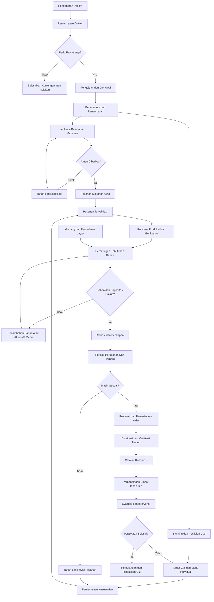

# BUSINESS REQUIREMENTS DOCUMENT (BRD)
# SISTEM MANAJEMEN ASUPAN GIZI PASIEN RUMAH SAKIT

| Informasi | Keterangan |
|---|---|
| Versi | 4.0 — Final Rancangan Bisnis |
| Tanggal | 8 November 2026 |
| Jenis Sistem | Sistem Manajemen Pelayanan Gizi Rumah Sakit Mandiri |
| Kapasitas Perencanaan | 100–500 pasien rawat inap aktif |
| Peran Utama | 10 peran |
| Status | Disetujui rumah sakit; acuan final proses bisnis dan operasional |

> **Ruang lingkup dokumen:** kebutuhan dan alur bisnis saja. Tidak mencakup pemilihan teknologi, arsitektur kode, atau rancangan database teknis.
>
> **Pengesahan:** BRD telah disetujui rumah sakit berdasarkan konfirmasi pemilik proyek. Pelaksanaan pelayanan mengikuti kewenangan profesi dan prosedur rumah sakit.

---

## BAB I. PENDAHULUAN

### 1.1 Latar Belakang

Pelayanan gizi merupakan bagian penting dalam perawatan pasien. Kebutuhan energi, protein, dan zat gizi lainnya berbeda menurut kondisi kesehatan, hasil pemeriksaan dokter, kemampuan makan, dan penilaian ahli gizi. Pemenuhan kebutuhan gizi tidak hanya bergantung pada penentuan menu, tetapi juga pada pengadaan bahan yang layak, perencanaan produksi, pengolahan, distribusi, konsumsi aktual, dan evaluasi.

Pada rumah sakit dengan lebih dari 100 pasien rawat inap, dapur perlu mengetahui jumlah porsi, jenis diet, kebutuhan bahan, kapasitas produksi, serta potensi perubahan kondisi pasien. Perencanaan makanan dilakukan sebelum hari pelayanan, sedangkan perubahan instruksi klinis harus dapat ditangani kapan saja tanpa memaksakan penggunaan makanan yang sudah tidak sesuai.

Sistem Manajemen Asupan Gizi Pasien Rumah Sakit dirancang sebagai sistem mandiri yang menghubungkan pendaftaran pasien sampai pemulangan dengan penyelenggaraan makanan dan pemantauan gizi. Keberhasilan sistem tidak hanya diukur dari makanan yang telah diserahkan, tetapi juga dari kesesuaian, keamanan, konsumsi aktual, dan tindak lanjut hasil evaluasi.

### 1.2 Permasalahan Bisnis

1. Identitas pasien, kunjungan, rawat inap, dan pelayanan gizi memerlukan keterhubungan informasi.
2. Instruksi diet dokter harus diteruskan kepada unit terkait secara tepat dan dapat ditelusuri.
3. Kondisi medis, alergi, tekstur makanan, dan kebutuhan gizi bersifat individual.
4. Nama penyakit saja tidak cukup untuk menentukan diet.
5. Jumlah pasien yang besar menghasilkan banyak pesanan dalam waktu yang berdekatan.
6. Dapur membutuhkan rencana produksi sehari sebelumnya.
7. Bahan yang dibutuhkan harus dihitung dari resep dan jumlah porsi.
8. Persediaan dan kelayakan bahan harus dipastikan sebelum produksi.
9. Perubahan diet mendadak dapat memengaruhi pesanan yang telah direncanakan, dimasak, atau dikirim.
10. Salah identitas, alergi, atau makanan yang tidak sesuai dapat membahayakan pasien.
11. Makanan yang diserahkan belum tentu dikonsumsi seluruhnya.
12. Asupan yang kurang membutuhkan evaluasi dan intervensi.
13. Ketidaksesuaian harus mempunyai penanggung jawab dan tindak lanjut.
14. Manajemen membutuhkan laporan yang konsisten dan dapat diaudit.

### 1.3 Tujuan Bisnis

1. Mengelola pelayanan dari pendaftaran hingga pemulangan pasien.
2. Memastikan instruksi pemberian makanan sah dan sesuai kewenangan.
3. Mendukung skrining, penilaian, dan perencanaan gizi individual.
4. Memeriksa menu terhadap alergi, pembatasan, tekstur, serta kondisi klinis pasien.
5. Menyusun perencanaan produksi hari berikutnya dan menangani perubahan mendadak.
6. Mengendalikan persediaan, kualitas, dan asal bahan makanan.
7. Menghubungkan permintaan bahan, produksi, distribusi, dan pasien penerima.
8. Mencegah makanan yang tidak sesuai diserahkan kepada pasien.
9. Menghitung empat tahap pemenuhan gizi: dibutuhkan, direncanakan, disajikan, dan dikonsumsi.
10. Mendukung intervensi, penilaian ulang, insiden, dan pengawasan.

### 1.4 Prinsip Bisnis

- **Keselamatan pasien didahulukan.** Ketidaksesuaian yang belum diselesaikan mengakibatkan penahanan makanan terdampak.
- **Kebutuhan individual.** Pasien dengan diagnosis sama tidak otomatis menerima diet sama.
- **Perencanaan lebih awal.** Rencana menu dan kebutuhan bahan dibuat sebelum hari produksi.
- **Instruksi terbaru berlaku.** Penutupan rencana reguler tidak mengesampingkan perubahan klinis.
- **Ketertelusuran.** Bahan, produksi, pesanan, distribusi, dan penerima harus dapat dihubungkan.
- **Distribusi bukan konsumsi.** Makanan diberikan tidak otomatis berarti makanan dimakan.
- **Tindak lanjut tertutup.** Peringatan dan insiden mempunyai penanggung jawab serta hasil penyelesaian.

---

## BAB II. RUANG LINGKUP BISNIS

### 2.1 Proses Dalam Cakupan

1. Pendaftaran dan kunjungan pasien.
2. Pemeriksaan awal dokter.
3. Pengajuan, penerimaan, penempatan, perpindahan, dan pemulangan rawat inap.
4. Instruksi pemberian makanan awal.
5. Pemeriksaan keselamatan pemberian makanan.
6. Skrining risiko gangguan gizi dan penilaian ahli gizi.
7. Penetapan kebutuhan gizi individual dan rencana intervensi.
8. Pemeriksaan kesesuaian diet terhadap kondisi pasien.
9. Katalog bahan, resep, menu, dan rencana menu individual.
10. Perencanaan menu berkala dan produksi sehari sebelumnya.
11. Perkiraan pasien, kapasitas dapur, dan pesanan mendadak.
12. Penerimaan, penyimpanan, pemeriksaan mutu, pengeluaran, serta pengembalian bahan.
13. Perhitungan bahan dan alokasi persediaan.
14. Persiapan, produksi, pemeriksaan akhir, pengepakan, dan pelabelan.
15. Distribusi serta verifikasi identitas pasien dan diet terkini.
16. Pencatatan konsumsi dan makanan tersisa.
17. Perbandingan empat tahap pemenuhan gizi.
18. Evaluasi, intervensi, dan penilaian ulang.
19. Penanganan pengecualian, insiden, gangguan, dan rekonsiliasi.
20. Pelaporan dan pengawasan lintas unit.

### 2.2 Di Luar Cakupan

Farmasi, laboratorium, radiologi, penagihan pasien, klaim asuransi, penggajian, akuntansi rumah sakit, pembelian beserta pembayaran pemasok secara menyeluruh, keputusan medis otomatis, dan penggantian seluruh fungsi rekam medis elektronik rumah sakit.

Dokumentasi pemeriksaan dokter dibatasi pada kebutuhan rawat inap dan pelayanan gizi. Pemberian nutrisi melalui selang maupun pembuluh darah memerlukan prosedur dan kewenangan klinis khusus; pencatatan lanjutan dapat dirancang secara terpisah dari proses makanan dapur.

### 2.3 Sistem Mandiri

Kegiatan dalam cakupan dicatat pada sistem sendiri, tanpa mengandalkan integrasi langsung dengan sistem informasi manajemen rumah sakit. Sebelum penggunaan klinis nyata, rumah sakit harus menetapkan kedudukan dokumentasi ini terhadap rekam medis resmi dan memenuhi persyaratan tata kelola informasi kesehatan yang berlaku.

---

## BAB III. PENGGUNA DAN TANGGUNG JAWAB

| No. | Peran | Tanggung Jawab |
|---:|---|---|
| 1 | Administrator | Pengguna, hak akses, pengaturan, dan audit teknis |
| 2 | Petugas Pendaftaran | Registrasi, identitas, kunjungan, dan antrean |
| 3 | Dokter | Pemeriksaan, pengajuan rawat inap, diet awal, dan keputusan klinis |
| 4 | Petugas Rawat Inap | Penerimaan, penempatan, perpindahan, dan pemulangan administratif |
| 5 | Perawat | Verifikasi keamanan, skrining gizi, pengamatan, dan konsumsi |
| 6 | Ahli Gizi | Penilaian, target kebutuhan, menu individual, intervensi, dan evaluasi |
| 7 | Petugas Gudang | Penerimaan, penyimpanan, persediaan, kualitas, serta pengeluaran bahan |
| 8 | Petugas Dapur | Perencanaan kerja, persiapan, produksi, dan pemeriksaan makanan |
| 9 | Petugas Distribusi | Pengiriman, pemeriksaan identitas, dan penyerahan makanan |
| 10 | Kepala Instalasi Gizi | Pengawasan proses, mutu, persediaan, insiden, dan laporan |

### 3.1 Prinsip Kewenangan

- Dokter menetapkan dan mengesahkan instruksi diet awal.
- Ahli gizi menilai kebutuhan gizi dan menyusun rencana intervensi; perubahan yang memerlukan keputusan dokter harus mendapat persetujuan.
- Perawat melaksanakan skrining dan observasi sesuai kompetensi.
- Petugas gudang tidak mengubah diet; petugas dapur tidak melakukan penggantian bahan yang memengaruhi keamanan atau kandungan gizi tanpa peninjauan yang diperlukan.
- Petugas distribusi tidak mengubah isi pesanan.
- Administrator teknis tidak mengambil keputusan klinis.
- Akses data dibatasi berdasarkan peran, unit, dan penugasan; tindakan penting mempunyai identitas pelaksana dan waktu.

---

## BAB IV. ALUR BISNIS PELAYANAN PASIEN

### 4.1 Pendaftaran Pasien

**Penanggung jawab:** Petugas Pendaftaran.

1. Cari pasien berdasarkan pengenal yang tersedia.
2. Verifikasi pasien lama atau buat identitas baru.
3. Periksa kemungkinan data ganda.
4. Buat kunjungan pemeriksaan.
5. Masukkan pasien ke antrean dokter.

**Aturan:** setiap pasien memiliki identitas utama unik; satu pasien dapat mempunyai banyak kunjungan; perubahan identitas penting dicatat.

**Keluaran:** kunjungan aktif.

### 4.2 Pemeriksaan Awal Dokter

**Penanggung jawab:** Dokter.

1. Verifikasi pasien.
2. Catat keluhan, pemeriksaan, diagnosis kerja, serta kondisi yang relevan untuk makanan.
3. Tentukan tindak lanjut: selesai atau pulang, rujukan, atau pengajuan rawat inap.

**Keluaran:** hasil pemeriksaan dan keputusan layanan.

### 4.3 Pengajuan Rawat Inap

1. Dokter mencatat alasan perawatan, prioritas, dan kebutuhan ruang.
2. Dokter menetapkan instruksi diet awal atau instruksi penundaan pemberian makanan.
3. Dokter mengesahkan pengajuan.
4. Petugas rawat inap memeriksa pengajuan dan ketersediaan ruang.
5. Pengajuan diterima, ditunda, ditolak, atau dibatalkan dengan alasan sesuai kondisi.

**Keluaran:** keputusan penerimaan pasien.

### 4.4 Penetapan Instruksi Diet Awal

Instruksi dokter mencakup jenis diet, tekstur, kemampuan menerima makanan melalui mulut, larangan makan atau minum melalui mulut, alergi dan pembatasan yang diketahui, informasi kondisi klinis, instruksi khusus, dan waktu mulai berlaku.

**Aturan:**

1. Diet biasa tidak dipilih secara otomatis untuk semua pasien.
2. Instruksi belum disahkan tidak dapat menghasilkan pesanan.
3. Larangan makan atau minum melalui mulut memblokir pesanan makanan melalui mulut.
4. Risiko menelan atau alergi yang belum jelas memerlukan klarifikasi.
5. Setiap revisi mempunyai versi dan waktu berlaku; instruksi yang digantikan tidak boleh dipakai untuk pesanan baru.

### 4.5 Penerimaan dan Penempatan

1. Petugas memilih bangsal, kamar, dan tempat tidur yang sesuai serta tersedia.
2. Konfirmasi penempatan dan buat episode rawat inap.
3. Daftar pasien bangsal dan tugas perawat diperbarui.
4. Instruksi diet awal tersedia untuk petugas berwenang.

Satu tempat tidur tidak boleh memiliki penempatan aktif yang bertabrakan. Perpindahan dicatat sebagai riwayat.

---

## BAB V. PELAYANAN GIZI KLINIS

### 5.1 Pemeriksaan Keamanan Makanan oleh Perawat

Verifikasi identitas pasien, instruksi diet terkini, alergi, pembatasan, kemampuan menelan, dan kemungkinan larangan makan atau minum melalui mulut.

Jika aman dan instruksi telah disahkan, pesanan makanan awal boleh diproses. Jika tidak sesuai atau belum pasti, pesanan ditahan dan diklarifikasi kepada dokter. **Pemeriksaan keamanan dapat berjalan sebelum penilaian lengkap ahli gizi selesai.**

### 5.2 Skrining Risiko Gangguan Gizi

Perawat menggunakan instrumen dan tenggat yang disahkan rumah sakit. Data dicatat, hasil diperoleh berdasarkan ketentuan instrumen, dan penilaian lanjutan ditugaskan kepada ahli gizi jika diperlukan.

### 5.3 Penilaian Kondisi Gizi

Ahli gizi meninjau skrining, diagnosis, kondisi klinis, kemampuan makan, informasi fisik, dan riwayat konsumsi; lalu menetapkan target energi, protein, dan zat gizi relevan. Target mempunyai waktu berlaku dan riwayat perubahan.

### 5.4 Pemeriksaan Kesesuaian Diet Berdasarkan Kondisi Medis

1. Dokter mencatat kondisi medis yang relevan.
2. Tenaga berwenang menetapkan pembatasan dan kebutuhan individual.
3. Rencana menu diperiksa terhadap instruksi aktif, alergi, tekstur, kemampuan menelan, dan kebutuhan gizi.
4. Ketidaksesuaian ditahan untuk perbaikan; konflik antaraturan diserahkan kepada dokter dan ahli gizi.
5. Pemeriksaan diulang setelah perubahan.

**Aturan:** diagnosis saja bukan aturan otomatis diet; pasien dengan diagnosis sama dapat mempunyai diet berbeda. Pemeriksaan otomatis hanya menerapkan aturan yang disahkan, bukan membuat keputusan klinis baru.

### 5.5 Perencanaan Menu Individual

Ahli gizi melihat target kebutuhan, memilih menu dan resep yang sesuai, membandingkan nilai gizi menu dengan target, memeriksa alergi serta pembatasan, lalu menyesuaikan menu atau porsi dan mengesahkan rencana sesuai kewenangan.

Perubahan resep tidak boleh mengubah nilai historis makanan yang sudah diberikan.

### 5.6 Pengelolaan Masalah Gizi

Masalah, bukti pendukung, tujuan, intervensi, penanggung jawab, jadwal evaluasi, dan hasil tindak lanjut dicatat. Persetujuan dokter diminta untuk perubahan yang memerlukan kewenangan medis.

---

## BAB VI. PERENCANAAN MENU DAN PRODUKSI

### 6.1 Tiga Tingkat Perencanaan

1. **Berkala:** siklus menu beberapa hari ke depan, perkiraan kebutuhan bahan, serta kesiapan gudang.
2. **Sehari sebelumnya:** jumlah porsi terkonfirmasi, instruksi diet, resep, kebutuhan bahan, kapasitas, dan jadwal kerja.
3. **Hari pelaksanaan:** verifikasi perubahan pasien dan diet, penanganan pesanan baru, pembatalan, serta pemeriksaan sebelum produksi dan distribusi.

Persiapan bahan lebih awal hanya dilakukan jika aman menurut prosedur keamanan pangan. Perencanaan sehari sebelumnya **tidak berarti semua makanan matang disiapkan sehari sebelumnya**.

### 6.2 Menu Berkala

Ahli gizi dan kepala instalasi menetapkan siklus menu, memeriksa komposisi, bahan, serta kapasitas. Menu berkala merupakan acuan, bukan pengganti menu individual pasien.

### 6.3 Perencanaan Produksi Sehari Sebelumnya

1. Periksa pasien aktif, rencana pasien masuk, dan perkiraan pasien pulang.
2. Periksa instruksi diet yang berlaku dan rencana menu individual.
3. Kelompokkan jumlah porsi menurut jadwal, jenis diet, resep, dan tekstur.
4. Hitung kebutuhan bahan serta tinjau persediaan layak pakai.
5. Periksa kapasitas peralatan, waktu persiapan, tenaga, pengepakan, dan pengiriman.
6. Buat jadwal pekerjaan produksi dan persetujuan penanggung jawab.
7. Tutup rencana reguler sesuai batas waktu rumah sakit.

**Keluaran:** rencana produksi per tanggal dan sesi makan, termasuk porsi, resep, bahan, pekerjaan, kapasitas, dan penanggung jawab.

### 6.4 Perkiraan Pasien

Jumlah pasien aktif, rencana penerimaan, perkiraan pemulangan, instruksi penundaan makan, dan jadwal makan digunakan untuk perencanaan kapasitas. Pasien yang diperkirakan masuk **tidak otomatis dibuatkan pesanan individual yang sah**.

### 6.5 Kapasitas Dapur

Periksa jumlah porsi, peralatan, waktu persiapan, waktu memasak, waktu pengepakan, jumlah petugas, dan kemampuan distribusi. Kelebihan beban harus menghasilkan penyesuaian jadwal atau penanganan operasional yang tetap aman.

### 6.6 Penutupan dan Revisi Rencana

Penutupan berlaku untuk rencana reguler. Perubahan instruksi klinis setelah penutupan harus diterima, dicatat sebagai revisi, dan ditangani terhadap pesanan, bahan, produksi, maupun distribusi terdampak.

### 6.7 Pesanan Mendadak

Pemicu meliputi pasien baru, perubahan kondisi dan diet, pembatalan larangan makan, atau kebutuhan penggantian makanan. Instruksi diperiksa, dampak pada produksi dinilai, pesanan yang tidak aman ditahan, alternatif diperiksa, dan keputusan disahkan sebelum diproses.

### 6.8 Menu Pengganti

Menu pengganti untuk kekurangan bahan, bahan tidak layak, perubahan diet, atau gangguan produksi harus diperiksa terhadap target, alergi, tekstur, dan pembatasan individual. Ahli gizi meninjau penggantian; persetujuan dokter diperoleh bila diperlukan.

---

## BAB VII. PENGELOLAAN GUDANG

### 7.1 Data Bahan

Nama, kategori, satuan, konversi, persyaratan penyimpanan, batas minimum, nilai gizi, bahan pemicu alergi, dan kelayakan penggunaan.

### 7.2 Penerimaan

Catat pemasok, jenis bahan, jumlah, tanggal penerimaan, kelompok penerimaan, kedaluwarsa jika berlaku, dan hasil pemeriksaan kualitas. Bahan yang belum lolos pemeriksaan tidak boleh digunakan.

### 7.3 Penyimpanan

Kelola lokasi, kondisi simpan, kelompok penerimaan, kedaluwarsa, dan status kelayakan. Prioritaskan bahan dengan kedaluwarsa terdekat yang masih layak sesuai ketentuan.

### 7.4 Kategori Persediaan

Bedakan stok fisik, stok layak, stok dialokasikan, stok ditahan, dan stok tersedia untuk permintaan baru.

### 7.5 Permintaan dan Pengeluaran

1. Dapur mengajukan kebutuhan dari rencana produksi.
2. Gudang memeriksa jumlah dan persediaan layak.
3. Bahan dialokasikan lalu dikeluarkan.
4. Dapur memverifikasi jumlah yang diterima.
5. Selisih dicatat.

Stok **tidak berkurang hanya karena rencana dibuat** dan tidak boleh dikeluarkan melebihi persediaan layak tersedia.

### 7.6 Pengembalian, Pemeriksaan Fisik, dan Pembuangan

Pengembalian harus melalui pemeriksaan kelayakan; penghitungan fisik berkala dibandingkan dengan catatan; koreksi memerlukan alasan dan persetujuan; bahan rusak atau kedaluwarsa ditahan dan dicatat ketika dibuang.

---

## BAB VIII. PRODUKSI DAN PENGENDALIAN MAKANAN

### 8.1 Kalkulasi Bahan

Kebutuhan dihitung dari jumlah pesanan sah, porsi, resep, satuan, kebutuhan bahan mentah, bagian bahan yang dapat digunakan, serta faktor kehilangan sesuai resep.

### 8.2 Persiapan

Petugas memeriksa bahan, memisahkan sesuai kebutuhan, melakukan persiapan sesuai resep dan prosedur keamanan pangan, serta mencatat penggunaan aktual dan bahan yang tidak layak.

### 8.3 Pengolahan

1. Periksa rencana produksi dan daftar pesanan sah.
2. Verifikasi resep, jumlah porsi, serta kelompok bahan yang digunakan.
3. Olah makanan sesuai ketentuan.
4. Catat pemakaian bahan dan hasil produksi.
5. Lakukan pemeriksaan akhir sebelum pengepakan.

### 8.4 Pemeriksaan Akhir

Periksa jenis makanan, porsi, tekstur, kesesuaian resep, penggantian bahan, alergi, kondisi keamanan pangan, dan instruksi diet. Makanan yang gagal pemeriksaan ditahan.

### 8.5 Pengepakan dan Label

Label memuat identitas pasien seperlunya, nomor pesanan, lokasi, jadwal makan, jenis diet, tekstur, informasi alergi atau pembatasan, serta identitas kelompok produksi. Informasi pasien hanya ditampilkan sesuai kebutuhan pekerjaan.

### 8.6 Ketertelusuran

Hubungkan pemasok → kelompok penerimaan → penyimpanan → pengeluaran → penggunaan produksi → kelompok produksi → pesanan → distribusi → pasien penerima.

Jika bahan bermasalah, semua kelompok produksi dan pasien terdampak harus dapat ditemukan untuk penahanan atau tindakan lanjutan.

### 8.7 Produk Bermasalah

Tahan makanan, hentikan distribusi terdampak, beri pemberitahuan, telusuri bahan dan produksi, tentukan penggantian bila aman, serta catat tindakan dan penyelesaian.

---

## BAB IX. DISTRIBUSI MAKANAN

### 9.1 Alur

1. Ambil daftar makanan yang lolos pemeriksaan akhir.
2. Kelompokkan tujuan menurut bangsal dan jadwal.
3. Periksa label, isi pesanan, dan tujuan.
4. Antar makanan.
5. Verifikasi sedikitnya dua pengenal pasien sesuai prosedur rumah sakit; nomor kamar bukan satu-satunya pengenal.
6. Periksa instruksi diet terkini.
7. Serahkan hanya jika seluruh syarat sesuai.
8. Catat status dan waktu penyerahan.

### 9.2 Perubahan Saat Pengiriman

Jika diet berubah, pesanan terdampak ditahan. Periksa instruksi baru, jangan serahkan makanan lama yang tidak sesuai, dan proses penggantian sesuai prosedur.

### 9.3 Status

Menunggu pengiriman, sedang dikirim, menunggu verifikasi, berhasil diserahkan, ditahan, gagal diserahkan, atau dibatalkan.

---

## BAB X. PEMANTAUAN ASUPAN GIZI

### 10.1 Pencatatan Konsumsi

Perawat atau petugas klinis yang ditunjuk memilih jadwal makan, melihat makanan yang benar-benar diserahkan, mencatat jumlah dikonsumsi dan sisa, metode pengukuran, alasan makanan tidak habis, serta waktu observasi. Perhitungan nutrisi kemudian diperbarui.

### 10.2 Kondisi Catatan

Dikonsumsi seluruhnya, sebagian, tidak dikonsumsi, tidak disajikan, ditolak, belum diobservasi, atau tidak dapat dipastikan. **Belum dicatat tidak sama dengan konsumsi nol.**

### 10.3 Penyebab Makanan Tidak Habis

Contoh: tidak nafsu makan, mual, gangguan menelan, tidak menyukai makanan, makanan terlambat, pemeriksaan lain, atau perubahan kondisi kesehatan.

### 10.4 Empat Tahap Pemenuhan

| Tahap | Makna |
|---|---|
| Dibutuhkan | Target gizi pasien yang berlaku |
| Direncanakan | Nilai gizi menu yang direncanakan |
| Disajikan | Nilai gizi makanan yang benar-benar diberikan |
| Dikonsumsi | Nilai gizi makanan yang benar-benar dikonsumsi |

Hasil pemantauan memuat target, jumlah tiap tahap, selisih, persentase pemenuhan, sumber nilai, dan kelengkapan pencatatan. Nilai historis menggunakan resep, porsi, dan target yang berlaku saat kejadian.

---

## BAB XI. EVALUASI DAN INTERVENSI GIZI

1. Ahli gizi meninjau target, catatan konsumsi, kondisi pasien, dan hambatan makan.
2. Masalah gizi dicatat dengan bukti pendukung.
3. Tujuan dan rencana intervensi dibuat.
4. Persetujuan dokter diperoleh untuk perubahan yang membutuhkan kewenangan medis.
5. Petugas pelaksana, tenggat, dan hasil tindakan dicatat.
6. Penilaian ulang dilakukan pada jadwal yang ditentukan.
7. Rencana dilanjutkan, diubah, atau diakhiri sesuai hasil.

Tugas yang selesai tidak otomatis berarti kondisi gizi telah membaik.

### 11.1 Pemulangan

Dokter menetapkan akhir perawatan, pesanan mendatang dihentikan, pesanan yang sedang berjalan ditangani, ringkasan gizi diselesaikan sesuai ketentuan, episode rawat inap ditutup, dan riwayat dipertahankan. Rujukan dan pasien meninggal dunia mempunyai prosedur penutupan tersendiri.

---

## BAB XII. PERUBAHAN DAN PENGECUALIAN

### 12.1 Perubahan Diet

Instruksi baru disahkan dan diberi waktu berlaku, pesanan terdampak dicari, makanan yang tidak aman ditahan, dapur serta distribusi diberi tugas penanganan, dan seluruh revisi dicatat.

### 12.2 Perubahan Pasien

Pasien baru, pindah kamar atau bangsal, pulang, dirujuk, meninggal dunia, serta perubahan medis mengharuskan pemeriksaan dampak pada pesanan dan distribusi.

### 12.3 Kekurangan Bahan

Gudang menyampaikan kekurangan; dapur meninjau alternatif; ahli gizi memeriksa menu pengganti; persetujuan klinis diambil jika diperlukan; rencana produksi diperbarui.

### 12.4 Gangguan Dapur

Gangguan peralatan atau fasilitas dicatat, produksi terdampak diidentifikasi, alternatif pekerjaan dibuat dengan tetap mempertahankan keamanan makanan, dan hasil penanganan didokumentasikan.

### 12.5 Insiden

Meliputi salah pasien, salah makanan, ketidaksesuaian alergi atau diet, bahan tidak layak, gangguan penyimpanan, makanan terlambat atau tidak sampai, serta kesalahan pencatatan.

**Alur:** laporkan → kendalikan risiko segera → tetapkan penanggung jawab → selidiki → putuskan tindakan → laksanakan → verifikasi → tutup secara sah.

---

## BAB XIII. STATUS DAN PERPINDAHAN PROSES

### 13.1 Instruksi Diet

Rancangan → menunggu pengesahan → berlaku sebagai diet awal atau diet hasil penilaian. Dapat ditinjau, menunggu perubahan, ditangguhkan, digantikan, atau dihentikan dengan kewenangan serta riwayat yang sesuai.

### 13.2 Rencana Produksi

Rancangan → menunggu pemeriksaan → disetujui → ditutup untuk pesanan reguler → sedang dilaksanakan → selesai. Pembatalan dan revisi mengikuti alasan serta catatan historis.

### 13.3 Pesanan Makanan

Rancangan → menunggu pemeriksaan → tervalidasi → masuk rencana produksi → sedang diproduksi → selesai dimasak → lolos pemeriksaan akhir → siap dikirim → dikirim → diserahkan.

Pesanan dapat **ditahan** pada setiap tahap terkait keselamatan; pembatalan atau penanganan lain harus mempertimbangkan tahap fisik makanan.

### 13.4 Persediaan

Menunggu pemeriksaan, layak digunakan, dialokasikan, ditahan, tidak layak, dikeluarkan, digunakan, dikembalikan, atau dibuang.

### 13.5 Ketentuan Umum

Perubahan status hanya melalui tindakan yang sah; persetujuan, koreksi, serta pembatalan harus mempunyai riwayat dan penanggung jawab.

---

## BAB XIV. ALIRAN INFORMASI ANTARUNIT

| Sumber | Informasi | Penerima | Tujuan |
|---|---|---|---|
| Pendaftaran | Identitas dan kunjungan | Dokter | Pemeriksaan |
| Dokter | Pengajuan dan pemeriksaan | Rawat Inap | Penerimaan |
| Dokter | Diet awal | Perawat dan Ahli Gizi | Keamanan dan penilaian |
| Rawat Inap | Status dan lokasi pasien | Perawat dan Distribusi | Penugasan dan pengiriman |
| Perawat | Skrining | Ahli Gizi | Penilaian lanjutan |
| Ahli Gizi | Target dan menu | Pemesanan | Pesanan individual |
| Pemesanan | Jumlah porsi dan resep | Dapur | Rencana produksi |
| Dapur | Kebutuhan bahan | Gudang | Alokasi dan pengeluaran |
| Gudang | Bahan dan asal persediaan | Dapur | Produksi |
| Dapur | Hasil dan identitas produksi | Distribusi | Pengiriman |
| Distribusi | Penyerahan makanan | Perawat | Catatan konsumsi |
| Perawat | Konsumsi aktual | Ahli Gizi | Evaluasi |
| Ahli Gizi | Intervensi | Dokter dan unit terkait | Tindak lanjut |
| Seluruh unit | Insiden | Penanggung jawab | Penanganan |

**Ketentuan konsistensi:** identitas pasien dan episode sama di seluruh proses; instruksi dan target menggunakan versi berlaku; pesanan hanya dari menu sah; produksi hanya dari pesanan tervalidasi; konsumsi hanya terkait makanan yang diberikan; evaluasi menggunakan periode data yang tepat.

### 14.1 Diagram Alur Bisnis

**Catatan:** pelayanan diet awal yang sudah sah dan aman dapat diproses sebelum penilaian ahli gizi lengkap. Diagram menggambarkan hubungan proses, bukan kewajiban menunggu seluruh langkah berjalan berurutan.

---

## BAB XV. PELAYANAN RATUSAN PASIEN

### 15.1 Cakupan

Rancangan alur bisnis mendukung perencanaan operasional 100–500 pasien aktif; kesiapan volume nyata harus dibuktikan dalam uji beban dan pengujian bersama pengguna.

### 15.2 Pengelompokan Kerja

Daftar kerja dapat dikelompokkan menurut bangsal, kamar, jadwal makan, diet, status proses, status konsumsi, dan tugas belum selesai.

### 15.3 Pemesanan Massal

Pesanan dibuat secara kolektif dari instruksi individual yang sah. Pesanan yang gagal pemeriksaan dipisahkan ke daftar pengecualian, bukan dipaksakan masuk produksi. Pemrosesan ulang tidak boleh membuat pesanan ganda.

### 15.4 Produksi Gabungan

Dapur mengelompokkan jumlah porsi menurut resep dan jadwal, tetapi hubungan tiap porsi ke pesanan pasien tetap dapat ditelusuri.

### 15.5 Daftar Kerja

Perawat melihat skrining dan konsumsi belum lengkap; ahli gizi melihat penilaian dan evaluasi; gudang melihat permintaan; dapur melihat sesi produksi; distribusi melihat pengiriman; kepala instalasi melihat keterlambatan dan insiden.

---

## BAB XVI. LAPORAN DAN PENGAWASAN

- **Pasien:** jumlah aktif, kunjungan, pengajuan, penerimaan, perpindahan, pemulangan, daftar per bangsal.
- **Gizi:** skrining, penilaian, target, instruksi diet, revisi, menu individual, pemenuhan, intervensi, penilaian ulang.
- **Gudang:** penerimaan, pengeluaran, stok minimum, kedaluwarsa, bahan tidak layak, penghitungan fisik, selisih.
- **Produksi:** rencana dan realisasi porsi, penggunaan bahan, selisih, revisi pesanan, makanan ditahan atau dibatalkan.
- **Distribusi:** dikirim, diserahkan, gagal, ditahan, ketepatan waktu, ketidaksesuaian.
- **Konsumsi:** makanan dikonsumsi dan tersisa, kelengkapan data, alasan tidak habis, perbandingan empat tahap.
- **Mutu dan insiden:** kejadian, tindakan, penanggung jawab, status penyelesaian.

Laporan dibatasi menurut kewenangan dan dapat dipilah berdasarkan periode, bangsal, serta kategori operasional yang relevan.

---

## BAB XVII. ATURAN BISNIS WAJIB

| Kode | Aturan |
|---|---|
| AB-001 | Setiap pasien mempunyai identitas unik |
| AB-002 | Setiap rawat inap mempunyai episode perawatan yang jelas |
| AB-003 | Instruksi diet dibuat dan disahkan oleh tenaga berwenang |
| AB-004 | Instruksi diet mempunyai waktu berlaku dan riwayat perubahan |
| AB-005 | Tidak ada pesanan tanpa instruksi diet sah |
| AB-006 | Diet tidak ditetapkan otomatis hanya dari nama penyakit |
| AB-007 | Alergi dan pembatasan diperiksa sebelum produksi serta penyerahan |
| AB-008 | Larangan makan atau minum melalui mulut memblokir pesanan melalui mulut |
| AB-009 | Diet awal sah dan aman dapat digunakan sebelum penilaian ahli gizi lengkap |
| AB-010 | Perubahan diet memicu pemeriksaan ulang seluruh pesanan terdampak |
| AB-011 | Menu individual mengacu pada kebutuhan dan instruksi pasien |
| AB-012 | Produksi reguler direncanakan sebelum hari pelayanan |
| AB-013 | Penutupan rencana tidak mengabaikan perubahan klinis |
| AB-014 | Kebutuhan bahan dihitung dari pesanan dan resep |
| AB-015 | Bahan tidak layak dilarang untuk produksi |
| AB-016 | Alokasi stok dibedakan dari pengeluaran aktual |
| AB-017 | Pengeluaran tidak boleh melebihi stok layak tersedia |
| AB-018 | Bahan yang digunakan dapat ditelusuri ke kelompok penerimaan |
| AB-019 | Hasil produksi wajib diperiksa sebelum distribusi |
| AB-020 | Identitas pasien harus diverifikasi sebelum penyerahan |
| AB-021 | Instruksi diet terbaru harus diperiksa sebelum penyerahan |
| AB-022 | Makanan yang ditahan tidak dapat didistribusikan |
| AB-023 | Makanan diserahkan tidak otomatis dianggap dikonsumsi |
| AB-024 | Konsumsi nol berbeda dari data belum dicatat |
| AB-025 | Perhitungan asupan memakai nilai nutrisi porsi aktual yang relevan |
| AB-026 | Evaluasi gizi dilakukan oleh tenaga berwenang |
| AB-027 | Aplikasi tidak menentukan perubahan terapi secara mandiri |
| AB-028 | Setiap tindak lanjut mempunyai penanggung jawab dan status |
| AB-029 | Insiden dilaporkan dan ditindaklanjuti |
| AB-030 | Koreksi catatan penting mempertahankan riwayat |
| AB-031 | Pemulangan menghentikan pembuatan pesanan berikutnya |
| AB-032 | Informasi hanya diakses sesuai kewenangan |
| AB-033 | Gangguan sistem mempunyai prosedur pelayanan sementara |
| AB-034 | Riwayat pelayanan dapat ditelusuri |
| AB-035 | Proses kritis memerlukan pemeriksaan atau persetujuan sesuai ketentuan |

---

## BAB XVIII. KETIKA SISTEM TIDAK TERSEDIA

1. Gangguan dilaporkan kepada penanggung jawab.
2. Prosedur sementara yang disahkan mulai digunakan.
3. Identitas pasien, alergi, dan instruksi terbaru diverifikasi melalui sumber yang dapat dipertanggungjawabkan.
4. Pesanan, produksi, distribusi, dan perubahan dicatat pada formulir sementara.
5. Informasi penting tetap dikomunikasikan ke unit terkait.
6. Setelah sistem tersedia kembali, catatan dimasukkan dan dicocokkan.
7. Duplikasi atau selisih diperiksa serta diselesaikan.
8. Rekonsiliasi disahkan dan mempunyai riwayat.

---

## BAB XIX. KRITERIA PENERIMAAN BISNIS

### 19.1 Pelayanan Pasien

1. Pasien baru dan lama didaftarkan dengan benar.
2. Dokter menyimpan hasil pemeriksaan.
3. Pengajuan rawat inap diproses dengan keputusan jelas.
4. Tempat tidur tidak dialokasikan secara bertabrakan.
5. Diet awal dapat dibuat dan disahkan.

### 19.2 Keselamatan Diet

6. Instruksi yang belum sah tidak menghasilkan pesanan.
7. Larangan makan atau minum melalui mulut memblokir pesanan yang bertentangan.
8. Alergi dan pembatasan diperiksa.
9. Menu tidak sesuai ditahan.
10. Perubahan diet memicu pemeriksaan ulang pesanan terdampak.

### 19.3 Perencanaan dan Gudang

11. Produksi hari berikutnya dapat direncanakan.
12. Bahan dihitung berdasarkan resep dan porsi.
13. Rencana tidak langsung mengurangi stok.
14. Bahan tidak layak tidak dapat digunakan.
15. Kekurangan stok terlihat dan ditindaklanjuti.
16. Pengeluaran bahan dapat ditelusuri.

### 19.4 Produksi dan Distribusi

17. Produksi memakai pesanan tervalidasi.
18. Asal bahan tercatat pada produksi.
19. Makanan gagal pemeriksaan ditahan.
20. Penyerahan didahului verifikasi pasien.
21. Perubahan diet saat produksi atau distribusi dapat ditangani.
22. Pasien penerima dapat ditelusuri ke kelompok produksi.

### 19.5 Monitoring dan Evaluasi

23. Konsumsi aktual dicatat.
24. Konsumsi nol dan belum tercatat dibedakan.
25. Empat tahap pemenuhan gizi dibandingkan.
26. Evaluasi dan intervensi dicatat.
27. Tindak lanjut mempunyai jadwal dan penanggung jawab.
28. Ringkasan gizi tersedia ketika pemulangan.

### 19.6 Keamanan dan Operasional

29. Hak akses sesuai kewenangan.
30. Tindakan penting mempunyai riwayat.
31. Insiden ditangani dan ditutup dengan benar.
32. Prosedur sementara tersedia ketika sistem bermasalah.
33. Proses diuji dengan simulasi ratusan pasien.
34. Laporan operasional dapat dibuat.
35. Pembatalan dan perubahan tidak menghasilkan data saling bertentangan.

---

## BAB XX. PENGESAHAN PROSES BISNIS

| Pihak | Materi Validasi |
|---|---|
| Manajemen Rumah Sakit | Cakupan dan tata kelola |
| Dokter | Pemeriksaan, diet awal, dan keputusan klinis |
| Perawat | Keamanan makanan, skrining, dan konsumsi |
| Ahli Gizi | Target, menu, intervensi, dan evaluasi |
| Kepala Instalasi Gizi | Produksi, distribusi, persediaan, dan pengawasan |
| Petugas Gudang | Penerimaan, kualitas, serta pergerakan bahan |
| Petugas Dapur | Persiapan dan pengolahan |
| Petugas Distribusi | Identitas dan penyerahan |
| Pengelola Informasi Kesehatan | Tata kelola catatan pasien |
| Penanggung Jawab Mutu dan Keselamatan | Pengendalian risiko dan insiden |

**Status pengesahan:** disetujui rumah sakit berdasarkan konfirmasi pemilik proyek.

---

## BAB XXI. PENUTUP

Sistem Manajemen Asupan Gizi Pasien Rumah Sakit mengelola proses dari pendaftaran, pemeriksaan dokter, rawat inap, diet awal, skrining dan penilaian gizi, menu individual, perencanaan produksi sehari sebelumnya, gudang, pengolahan, pemeriksaan akhir, distribusi, konsumsi, evaluasi, intervensi, sampai pemulangan.

Sistem juga mengendalikan perubahan diet mendadak, kekurangan bahan, insiden makanan, gangguan produksi, dan proses saat aplikasi tidak tersedia. Fokus utamanya adalah memastikan bahwa makanan sesuai instruksi klinis, bahan layak dan terlacak, pasien penerima benar, konsumsi tercatat, serta masalah pemenuhan gizi ditindaklanjuti.

**Dokumen BRD Versi 4.0 Final ini telah disetujui rumah sakit dan menjadi acuan final kebutuhan bisnis.** Aplikasi dijalankan secara lokal dengan kewenangan profesi, keamanan pangan, dan tata kelola informasi sesuai prosedur rumah sakit.
